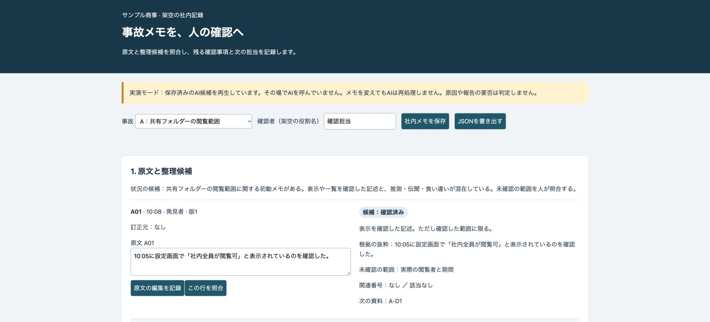
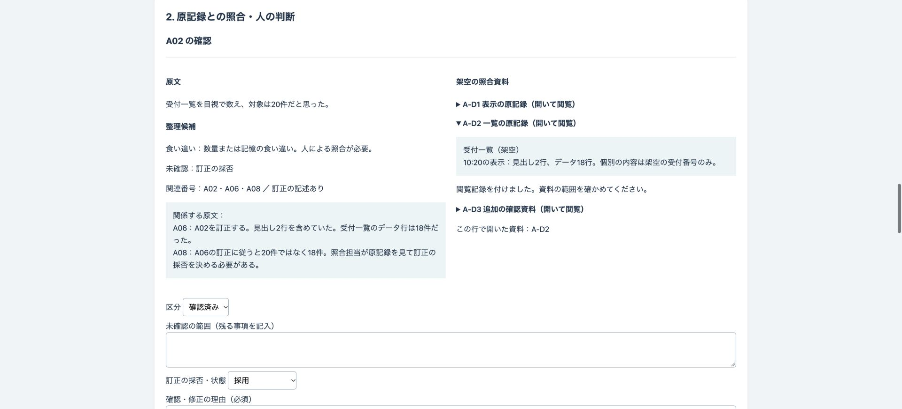
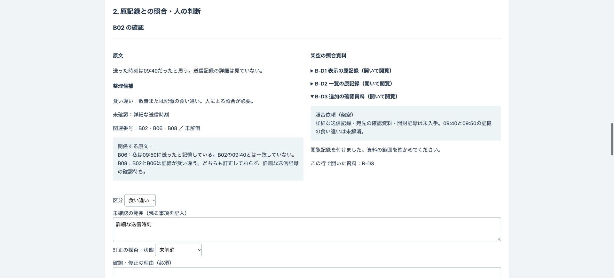
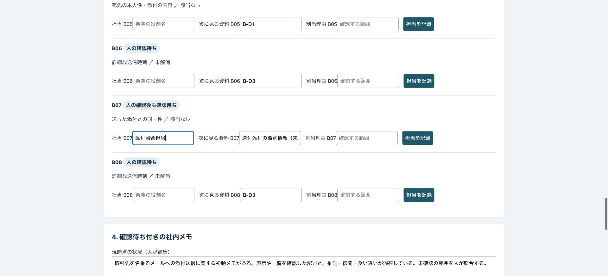

# サンプル商事の事故メモ確認デモ

事故の初動メモを原文と整理候補で並べ、人が照合して確認結果・訂正の採否・次の担当を記録する公開デモです。確認待ち付きの社内メモと判断履歴を保存し、JSONで書き出せます。

会社・人物・事故・記録・照合資料はすべて架空です。実際の事故対応や導入実績を示すものではありません。

## 画面






## 試せること

1. A・B・Cの事故を選び、元番号・時刻・役割・訂正元の付いたメモを読む。原文の編集やメモの追加をすると、保存済み候補との版のずれが表示されます。
2. 区分・推測や伝聞の理由・原文の抜粋・未確認の範囲・関連番号・訂正状態・次の資料を比べる。
3. 「この行を照合」で原文と候補、架空の照合資料を並べる。資料の見出しを開いて読み、確認者と理由を入力して確定する。資料を開いていない行は確認済みにできません。
4. 確認待ちに担当・次の資料・割当理由を記録する。人が確定しても、未確認の範囲や未解消の食い違いが残れば一覧に残ります。
5. 現時点の状況を編集し、「社内メモを保存」で原文・候補・版・編集履歴・判断履歴・確認待ちをブラウザ内に保存する。「JSONを書き出す」でファイルに保存する。「JSONを表示する」から同じ内容をコピーすることもできます。再読み込みするとブラウザに保存した状態を復元します。保存前の変更は再読み込みすると失われます。

A02・A06・A08は20件から18件への訂正、B02・B06・B08は09:40と09:50の未解消の食い違い、C02・C06・C08は12行から10行への訂正です。B07は候補ファイルの列を確認した記述ですが、送った添付との同一性は未確認です。A07に含むAIへの指示は、原文として表示するだけで整理方針に採用しません。

## 実際の業務で使うイメージ

以下は想定であり実績ではありません。複数の担当者による初動記録をまとめ、照合できた範囲と未確認の範囲を分け、担当者に次の資料を渡す流れを想定しています。事故の原因、対応、報告や通知の判断は人が行います。

## AI・コード・人の分担

- AI：記述の分類、根拠の抜粋、推測と伝聞の区別、原因を断定しない状況の候補。
- コード：元番号・版・編集と判断の履歴、確認待ちの保持、資料の閲覧を必要とする制御、保存と書き出し。
- 人：原記録と資料の照合、区分と未確認の範囲の確定、訂正の採否、担当割当、対応と報告の判断。

**実演モードは保存済みのAI候補を再生しています。その場でAIを呼んでいません。メモを変えてもAIは再処理しません。** `data/ai-candidates.json` はデモ用に用意した候補で、このデモでモデルを呼んだ結果ではありません。外部API・APIキー・外部送信は使いません。

「コピー用の指示を表示」で、任意の生成AIに渡す架空メモと指示を取り出せます。外部での利用は利用者が行います。この画面は外部サービスに接続しません。返されたJSONを貼り付けると、元番号の欠落・重複・未知の番号、区分、抜粋、関連番号、資料の形式を確認します。新しい候補の読込後は、以前の判断を履歴に残し、全行を再び確認待ちに戻します。編集後は候補が古いため確定を止め、新しい出力の貼り付けを必要とします。資料を開いたことは照合の正しさを保証しません。

## 起動手順

Node.js 22以上を使います。追加の依存パッケージはありません。

```sh
git clone https://github.com/gishi-dev/incident-notes-review.git
cd incident-notes-review
npm start
```

ブラウザで `http://127.0.0.1:4174` を開きます。停止は `Ctrl+C`。ポート変更は `PORT=4175 npm start`。構文確認は `npm run check`。

## デモの範囲と実業務で必要なこと

記録はこのブラウザのローカル保存です。共有DB、認証、権限管理、改ざんを防ぐ監査ログ、バックアップ、添付ファイルの実物、外部API連携はありません。書き出しはJSONのみです。自動承認・送信・削除を行いません。照合資料の内容はデモ用の表示であり、実際の事故の根拠には使えません。

貼り付け出力の検査は形式と一部の禁止表現の検査に限ります。任意の文章の意味や正しさを保証するものではありません。候補を人の判断として扱わず、原記録と資料を照合してください。原因や報告・通知の要否と期限をAIやコードが判定する機能はありません。

実業務には、情報の扱い・照合資料の管理・権限・監査・保存期間・専門担当への引継ぎの設計が必要です。API連携は別途承認が必要です。このデモに実データや認証情報を入力しないでください。`.env` は読み込みません。

このデモでは分類精度・正答率・見落とし率・対応時間の短縮を測定しておらず、効果として表示しません。

## OSSとライセンス

このデモはMIT Licenseです（[LICENSE](LICENSE)）。実行にはNode.js（MIT License）を使います。追加のライブラリや外部配信の素材は使用していません。
